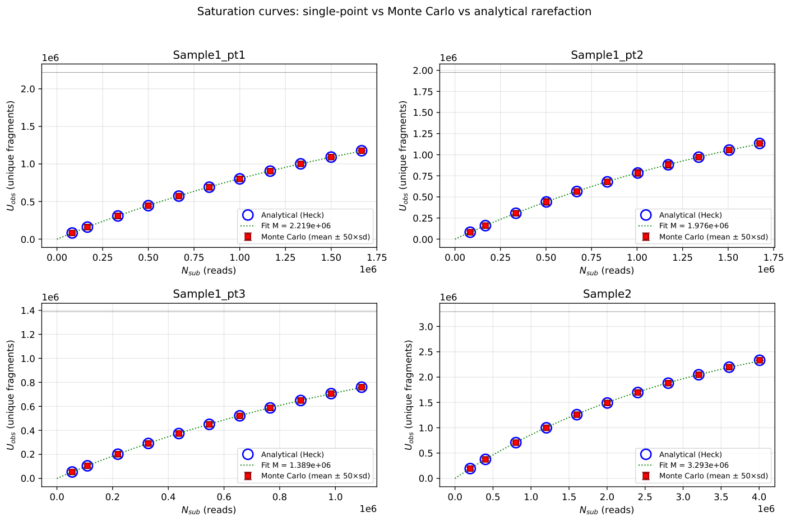
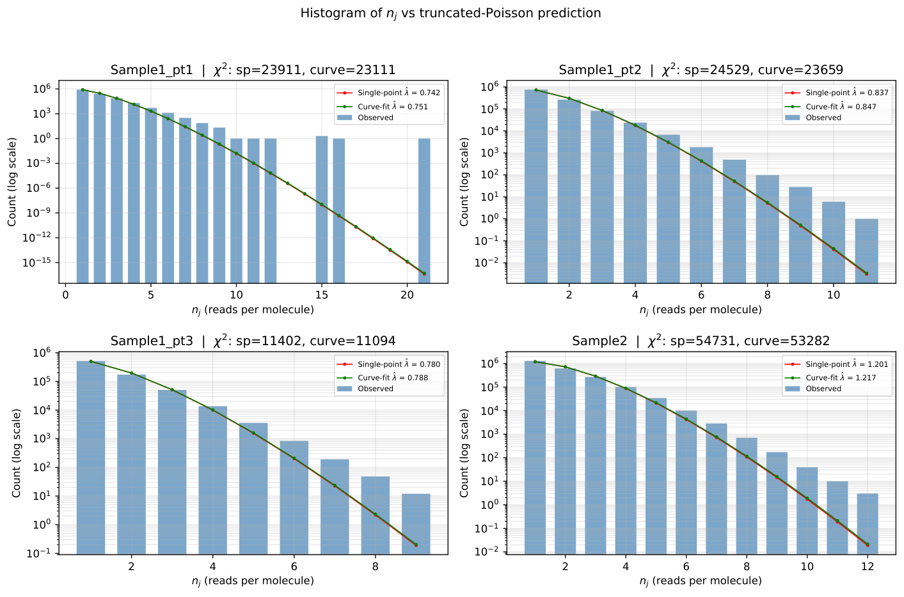

# Sequencing Library Complexity


**How much of a sequencing library remains unseen, and how much should we trust the estimate?** A Computational Genomics coursework case study combining likelihood-based estimation, rarefaction, model checking, and fragment-length stratification.

I derived the zero-truncated Poisson likelihood, implemented single-point and saturation-curve estimators, compared exact rarefaction with Monte Carlo expectations, and examined length-dependent read multiplicity. The analysis then uses a model-based reconstruction to ask whether accounting for length improves agreement between three parts of one sample.

[Read the report](docs/report/report.pdf) · [Methods and findings](docs/METHODS.md) · [Run the code](docs/RUNNING.md)

## From estimation to model checking

[](docs/report/q2a_saturation.pdf)

The original report finds single-point and rarefaction-fit complexity estimates within approximately **1.0–1.3%**, while count histograms reveal substantial departure from the shared-rate Poisson model. Close estimates do not establish a good generative model.

[](docs/report/q2b_histograms.pdf)

Length-stratified reconstruction improves two of three pairwise sample-part comparisons; mean total variation distance decreases from approximately **0.023 to 0.014** in the report. This is a partial internal consistency check, not ground-truth recovery of pre-PCR molecule counts. Length associations do not identify a specific PCR or library-preparation mechanism.

## Try it without the course data

```sh
python -m pip install -r requirements.txt
python tools/demo.py
```

This runs all five original analysis scripts on a small, explicitly synthetic fixture and writes demonstration plots to `demo-output/`. It checks the execution route; it does not reproduce the reported biological results. The supplied sequencing tables are excluded from this release.

For the detailed argument, assumptions, and limitations, start with [the methods guide](docs/METHODS.md). Two original background primers explain [rarefaction](docs/primers/subsampling_primer.pdf) and [statistical testing](docs/primers/stats_primer.pdf). [Sources and release scope](SOURCES.md) distinguish original coursework artifacts from packaging additions.
