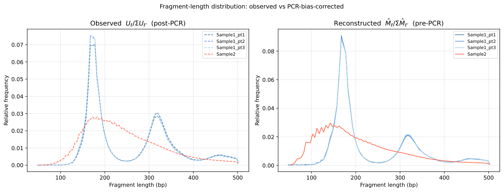

# Methods and findings

This is a coursework statistical analysis, not an independently validated sequencing assay or a general-purpose correction package. Numerical findings below are preserved from the original [report](report/report.pdf); this packaging pass did not rerun the supplied datasets.

## Observation model and estimators

Let `N` be total reads, `U` observed distinct fragments, `M` underlying library size, and `lambda` the mean read count per original molecule. Under a homogeneous Poisson working model, observed positive counts follow a zero-truncated Poisson distribution. The likelihood equation is `lambda / (1 - exp(-lambda)) = N/U`, solved with Brent's method; the resulting complexity estimate is `N/lambda`.

`analysis/q2a.py` compares this endpoint estimator with a least-squares saturation-curve fit. Exact rarefaction computes the expected number of observed fragments under subsampling using log-binomial coefficients. Monte Carlo uses independent per-fragment hypergeometric draws: their marginal probabilities are exact and their expected unique count is correct, but their joint total is not fixed. Its trial variance is therefore not that of a genuine joint sample without replacement. Plotted error bars in this figure are explicitly amplified **50 times** in the code/legend.

`analysis/q2b.py` compares empirical multiplicity histograms against the fitted zero-truncated Poisson model using Pearson statistics with right-tail merging. The substantial mismatch matters more than the approximately 1.0–1.3% agreement between the endpoint and curve-fit complexity estimates. These are model-dependent estimates, not known library sizes.

## Length stratification

- `q3a.py`: estimate rates in 5 bp bins, retaining bins with at least 50 observed fragments and more reads than distinct fragments.
- `q3b.py`: compare shared versus file-specific rates by likelihood-ratio statistics; report raw, Benjamini–Hochberg, and Bonferroni thresholds in log probability space. The report records 86/91 raw/BH and 78/91 Bonferroni rejections. Large sample sizes make small differences detectable; significance is not biological effect size.
- `q3d.py`: form `M_hat[length] = N[length] / lambda_hat[length]`, normalize over retained bins, and compare sample-part distributions with total variation distance.

The report's three sample-part comparisons change approximately `0.032 -> 0.008`, `0.028 -> 0.019`, and `0.008 -> 0.015`. Two improve and one worsens; average distance decreases from 0.023 to 0.014. This supports only a partial internal-consistency improvement.

## Interpretation boundaries

The global model is visibly misspecified. Length stratification still assumes homogeneity within each bin; a per-bin goodness-of-fit analysis was not run. GC content, sequence context, mapping, and preparation effects are not separately modeled. No pre-PCR ground truth is provided, so the absolute correction magnitude is unverifiable, and fragments physically removed during preparation cannot be recovered.

The archived report offers stronger mechanistic/biological readings (PCR efficiency, size selection, cfDNA and nucleosome interpretations). Treat these as hypotheses, not established causes or verified sample identities. The empirical rate curves alone do not separate amplification, sequencing, preparation, and other effects. Distribution agreement between related sample parts is not independent validation of a true pre-PCR distribution.

The original report is retained for transparency. This guide states the narrower claim appropriate to a portfolio: implement the estimator, check its assumptions, and quantify a limited model-based improvement.
